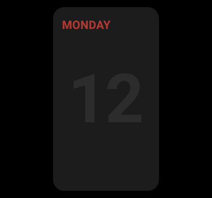
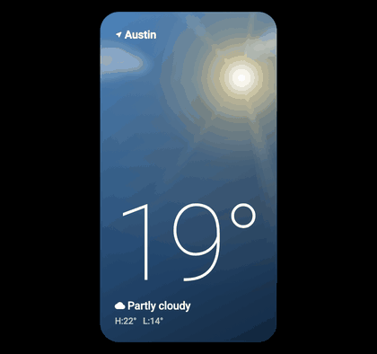
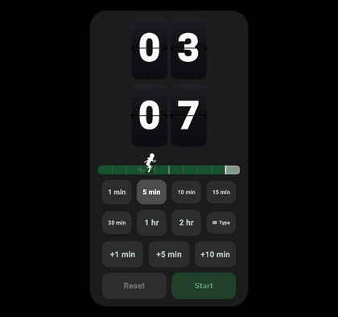
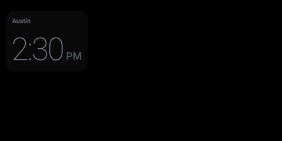
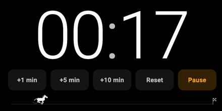
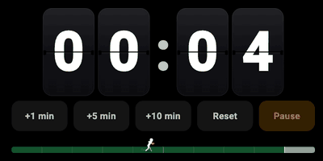
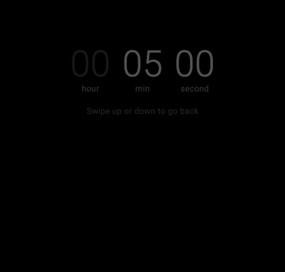

# Hushdock

[](LICENSE)
[](#platforms)
[](#)

Hushdock turns a charging phone into a bedside display: big readable clocks, live weather, a calendar, a timer and a Spotify now-playing card, designed for a dark room. It is built with Flutter for Android and iPhone (and, experimentally, Windows), and is based on the open-source Standby Pro project.

The look is inspired by iOS StandBy, but the layouts, themes, controls and motion are original. The interface is built to feel like iOS: springs instead of fixed-time animations, glass surfaces, press feedback on touch-down, and layouts that rearrange themselves when you turn the phone.

<p align="center">
  
  
</p>
<p align="center">
  
  
</p>
<p align="center">
  
</p>

*The clock screenshots are from an Android phone. The settings dock, the music screenshots and every animation below are rendered from the app's own widgets with sample data (`app/tool`).*

## Features

### Clocks

Digital, analog, frame, flip, mono, float, text and world clock. Colors are set per part (hours, minutes, colon, label, ticks), with presets such as "Red & white" and "Night red". 12/24-hour time, optional seconds and adjustable size.

Held upright, the clocks stack the hours over the minutes so the digits fill the tall screen; turned sideways they go back on one line. The parts glide between the two arrangements. The world clock searches any city in the world on the app's own keyboard.

<p align="center">
  
</p>

The flip clock gives every digit its own hinged card, and AM / PM is a small card too. A digit only flips when it changes.

<p align="center">
  
</p>

### Weather and calendar

- **Weather:** animated scenes (sun, clouds, rain, snow, fog, storm, night sky) from your phone's location. Swipe up and down for four pages: now, Fahrenheit, the forecast, and a second city.
- **Calendar:** today or the whole month (swipe up or down). The text scales with the panel in portrait and landscape, and the days land one after another when it appears.

Turn the phone and the calendar, the weather and the timer glide their parts from the portrait arrangement to the landscape one instead of swapping.

<p align="center">
  
  
  
</p>
<p align="center">
  
</p>

### Summary

One panel of widgets: the time here, the time in a second city, the date, the weather, the music card and the timer. Hold any tile and they jiggle like the iOS home screen: tap the red **-** to remove a widget, tap the dashed **+** to add one back, drag a tile onto another (or onto the empty place) to move it, then tap Done. There is room for three columns, and the arrangement is saved. It is only available with one panel.

<p align="center">
  
</p>

### Timer

A big digital or flip countdown with a small figure running along a track under it as the time goes: a horse towards a finish flag, or a football player towards the end zone. When the time is up the player scores: confetti and fireworks, a sound and a buzz, repeating every three seconds until you press Stop. The figures are a few strokes that only move with the clock, so a running timer costs next to nothing.

<p align="center">
  
  
</p>

- **Buttons:** +1, +5 and +10 minutes, Reset, Start / Pause, and quick lengths from 1 minute to 2 hours. It also fits the Summary tile, whatever its shape.
- **Type a length:** tap the time. A window slides up with the app's own number pad; swipe it down or press X to go back.
- **Own look and sound:** its own colors (separate from the clock's), and an alarm, a chime or a fanfare, with an optional buzz. On Android a phone on silent buzzes instead.

<p align="center">
  
</p>

### Music and Spotify

The music card shows what is playing with a sharp cover over a soft blurred backdrop, transport and 10-second skips, hold the progress bar to seek, and a source menu to pick a device. Its header has three small buttons: **queue**, **search** and **volume**.

<p align="center">
  
</p>

Sign in with Spotify to control playback on any device: a Mac, a speaker, a TV or the phone (Spotify Premium is needed for control).

- **Play goes to the right place.** With nothing playing, Play starts on this phone (it opens Spotify first if needed). A song or playlist you pick goes to the device that is already playing.
- **Search** on the app's own keyboard, so the phone's keyboard never covers the screen. Tap a result to play it, or **+** to add it to the queue.
- **Queue** shows what is playing and what is next. Tap a song to jump straight to it. Drag a song to reorder; Spotify's public API cannot move a queued song, so the new order takes effect as the current song ends.
- **Playlists** open into their songs: tap one and it plays with the rest of the playlist after it.
- **Volume** of the playing device, from the card or the music settings.

<p align="center">
  
  
</p>

### Layout and gestures

- **One or two panels.** Pinch with two fingers: spread for one panel (the one you spread on), pinch together for two.
- **Swipe sideways** to change the card; **swipe up or down** to change the clock style, the calendar view, the weather page or the timer style.
- **Page indicator.** After a swipe, small symbols show the pages for a moment. Press one and slide: a glass strip names each page under your finger, and lifting goes there.
- **Settings dock.** Tap any panel to open a dock whose changes preview live behind it. Drag its header to move it away.
- **Fits any screen.** Everything is laid out on a standard phone size and scaled to the real screen, in portrait and landscape.

<p align="center">
  
</p>

### Night and battery

- **Auto brightness:** the screen stays on while charging and follows the room light, like Apple's StandBy, with eased changes so a passing shadow does not flicker it.
- **Night mode:** your own hours, and it also starts when the room is dark. Colors fade to a dim red, amber or your accent, with no blue light.
- **OLED care:** the whole screen glides to a new spot once a minute on a slow orbit that never repeats, and it drops to about half brightness after 2, 5 or 10 minutes without a touch.
- **Battery badge** in the top-right corner when the battery is not full, and a **low-battery prompt** at a level you choose (default 20%).

<p align="center">
  
</p>

### Rotation and auto-start

- If the screen is not turned the way you hold the phone (for example iPhone rotation lock is on), Hushdock follows the phone by itself after a moment, using the gravity sensor, and notices a 180-degree flip. It never rotates while you are touching the screen.
- **Android only:** Hushdock opens itself when the phone is charging and propped up in landscape, and closes when you unplug (see [Android auto-start](#android-auto-start)).

### Accessibility

Controls are at least 28 pt, secondary text is at least 4.5:1 contrast, and Reduce Motion and the in-app **Animations** switch turn off every spring, slide and moving backdrop. For screen readers the page dots are labelled buttons, a clock reads as one sentence, and every swipe or drag has an action instead ("Next panel", "Move earlier", "Remove from Summary").

## Platforms

| Feature | Android | iPhone | Windows | Mac |
|---|---|---|---|---|
| All clock styles, themes, presets, layouts, pinch | Yes | Yes | Yes (pinch needs a touch screen) | Yes (pinch works on the trackpad) |
| Weather, calendar, world clock | Yes | Yes | Yes (weather needs Windows location services) | Yes (weather needs Location Services) |
| Night mode, burn-in shift, keep awake | Yes | Yes | Yes (keep-awake holds the display on while the app is open) | Yes (keep-awake holds the display on while the app is open) |
| Brightness that follows the room light | Yes, with the light sensor | Through iOS's own auto-brightness (iPhone does not let apps read the sensor) | No | No |
| Night look when the room is dark | Yes | No (hours only) | No (hours only) | No (hours only) |
| Spotify account control and volume | Yes | Yes | Yes | Yes |
| Battery badge and low-battery prompt | Yes | Yes | Laptops only | Laptops only |
| Spotify search and queue | Yes | Yes | Yes | Yes |
| Follows the phone's rotation (works with rotation lock on) | Yes | Yes | No | No |
| Show and control music from other apps on the phone | Yes | No (iOS does not allow it) | No | No |
| Open itself when docked and charging | Yes | No (iOS does not allow it; use the built-in StandBy) | No | No |

### Mac app

The same app builds as a Mac program, `Hushdock.app`. It opens on the clock in a window that fills the screen under the menu bar; the green button (or ⌃⌘F, or F11) goes to full screen and Esc or F11 leaves it. It has the same keyboard as Windows (see the table above), plus: a trackpad's two-finger swipe changes the card, a trackpad pinch switches between one panel and two, and a mouse wheel over a card works like a swipe. While you type in the Spotify or city search, the real keyboard types into it and the one-key shortcuts (N, S, D...) stand aside; Esc goes back. The timer's end sound (alarm, chime, fanfare) plays on the Mac too.

**Keep awake** holds the display on while Hushdock is open. The burn-in shift is off on a Mac (its screen is not an OLED left on all night). Weather needs Location Services (System Settings > Privacy & Security > Location). **Spotify on a Mac:** with nothing playing, **Play** starts music on this Mac; if Spotify is closed, Hushdock opens it, plays on the device named after your Mac and comes back to the front. Without Spotify installed, the message offers **Get Spotify**.

To build and install it, see [Mac](#mac) under Getting Started.

### Windows app (experimental)

The same app builds as a Windows program, `Hushdock.exe`. It has been built and run on Windows 11 (Flutter 3.47.7, Visual Studio 2026): the release build needs no fixes, it opens on the clock, mouse swipes change the card, a click opens the settings dock, the layout follows the window from wide to portrait to small, weather loads, the Float clock runs without a tilt sensor, and Spotify sign-in works.

**What works:** every clock style, themes and layouts, weather and calendar, the world clock, timer, Summary, and Spotify (account control, search, queue, volume). **What a PC does not have:** a tilt sensor (the Float clock does not sway and the rotation hint is off), a charger to watch (no auto-start), a light sensor (no brightness that follows the room), and the phone's media sessions (no "music from other apps"). The battery number shows on laptops only. **Keep awake** (Settings) stops the display and the PC from sleeping while Hushdock is open; closing it hands control back to your power plan.

**Full screen:** press **F11** (or Settings > Window & keyboard > Full screen) for a borderless display over the whole monitor, taskbar included. **Esc** or F11 leaves it and puts the window back where it was. Hushdock remembers it and starts in full screen next time. The mouse pointer hides after 3 still seconds.

**Keyboard:**

| Key | What it does |
|---|---|
| ← → | Previous / next card (like a sideways swipe) |
| ↑ ↓ | Next / previous clock style (like a swipe up or down on the clock) |
| Shift + arrows | The same on the second card, with two panels |
| 1 / 2, or D | One panel / two panels (D switches between them) |
| S or Enter | Open or close the settings for the card |
| Space | Play / pause the music, or start / pause the timer, when that card is showing |
| N | Night look on or off (until the night hours next start or end) |
| F11 | Full screen |
| Esc | Close settings, then leave full screen |
| 0 – 9 | Type a time on the timer's number pad (Backspace takes one back, Enter is done) |
| ? or F1 | Show these keys |

Keys never fire while you are typing in a text field.

**Battery:** the display stays light. The clock redraws only when its digits change, and nothing moves while the window is hidden or minimized. The weather backdrop waits for its card to finish sliding in, plays its rain, snow or clouds for 2 seconds, slows to a stop and then stays a still picture (it plays again for new weather or when you come back to the app). On a PC on mains power it plays at 30 frames a second instead of 20. When you change cards, each card is drawn once into a picture and the picture slides and fades, so even the frosted-glass, blurred-cover and weather cards change smoothly on a big screen. The weather's sky and clouds are kept as one picture while only the rain or snow moves. Album art and thumbnails are scaled smoothly, so they stay sharp on a big monitor.

To build and install it, see [Windows PC](#windows-pc) under Getting Started.

**Spotify on a PC:** with nothing playing, **Play** starts music on this PC. If the Spotify desktop app is closed, Hushdock opens it, waits for it to appear as a Spotify device (the one named after your PC), plays there and comes back to the front. Without the Spotify app installed, the message offers **Get Spotify**.

### Android auto-start

When enabled, a small foreground service watches the charger. While charging, it reads the gravity sensor at a low rate and opens Hushdock once the phone has been propped up (default 40° or more from flat) in landscape for 1.5 seconds. It closes the app as soon as you unplug, but only if it opened itself and you have not taken over the screen (opened it yourself, or pressed Home). To launch from the background it uses "Display over other apps" and a full-screen notification over the lock screen. In the app go to Settings > All settings > Auto-start; a checklist there shows what still needs to be allowed (overlay, notifications, battery set to Unrestricted).

## Permissions

| Platform | Permission | Used for |
|---|---|---|
| Both | Location, only while the app is open | Local weather and your city name |
| Both | Internet | Weather (Open-Meteo, BigDataCloud) and Spotify |
| Both | Motion sensor (no prompt needed) | The rotation hint reads the gravity direction |
| Android | Light sensor (no prompt needed) | Auto brightness and the dark-room night look |
| Android | Notification access (optional) | Reading what other apps are playing |
| Android | Display over other apps, full-screen notifications, foreground service, boot completed, wake lock | Auto-start and keeping the tilt sensor alive while charging |
| iPhone | None beyond location | |
| Windows | Location services (Settings > Privacy & security > Location) | Local weather and your city name |

Your location is used only to look up weather and a city name and is not stored anywhere but on your device.

## Getting Started

Hushdock is one Flutter app. You build it on your own computer and install it on the device you want to use as the display. Which computer can build for which device:

| Device | Build it on | Guide |
|---|---|---|
| Android phone or tablet | a Mac or a Windows PC | [Android](#android) |
| iPhone | a Mac (Apple's tools only run on a Mac) | [iPhone](#iphone) |
| Windows PC | a Windows PC | [Windows PC](#windows-pc) |
| Mac | a Mac | [Mac](#mac) |

### 1. Get the code

```bash
git clone https://github.com/HardikKotangale/Hushdock.git
cd Hushdock
```

### 2. Install the tools

The full checklist with versions is in [requirements.txt](requirements.txt). Easiest is to let a script install whatever is missing:

| Your computer | Run | Sets up |
|---|---|---|
| **Mac** | `./scripts/setup_mac.sh` | Flutter, JDK 17, Android Studio, CocoaPods: Android and iPhone |
| **Windows** | `.\scripts\setup_windows.ps1` (in PowerShell) | Flutter, JDK 17, Android Studio: Android. For the Windows app, also install Visual Studio (see [Windows PC](#windows-pc)) |

Add `--check` (Mac) or `-Check` (Windows) to only see what is missing without installing anything. Both scripts are safe to run again. They install Flutter, JDK 17 and Android Studio (plus CocoaPods on a Mac), set Flutter up to use JDK 17, accept the Android licenses, run `flutter pub get` and finish with `flutter doctor`.

> The Mac script has been tested. The Windows script follows the same steps but has not been run on a Windows PC yet. If it fails, the manual steps below do the same thing.

**Manual install, if you prefer**
1. Install [Flutter](https://docs.flutter.dev/get-started/install) (3.41 or newer) and make sure `flutter` works in a new terminal.
2. For Android: install JDK 17 and tell Flutter to use it (`flutter config --jdk-dir <path to JDK 17>`), install [Android Studio](https://developer.android.com/studio), open it once to finish its setup wizard, then run `flutter doctor --android-licenses` and answer `y`.
3. For iPhone (Mac only): install Xcode from the App Store, then `brew install cocoapods`.
4. For the Windows app: Visual Studio, as in [Windows PC](#windows-pc).
5. Run `flutter doctor` and fix anything it marks with a cross for the platforms you want.

### 3. Spotify (optional, any platform)

1. Create an app at <https://developer.spotify.com/dashboard> and add the redirect URI `hushdock://spotify-callback`.
2. Copy `app/assets/local/spotify.example.json` to `app/assets/local/spotify.json` and paste your Client ID. That file is git-ignored, so your Spotify app is never committed. (The setup scripts create the file for you.)
3. Or pass it at build time: `flutter run --dart-define=SPOTIFY_CLIENT_ID=your_id`.
4. In the app, open the music card's settings and tap **Connect Spotify**. Spotify Premium is needed to control playback.

Do this before you build: the Client ID is built into the app.

**A different redirect URI.** If your Spotify app is registered with another redirect URI, set `SPOTIFY_REDIRECT_URI` in the same `spotify.json` (or `--dart-define=SPOTIFY_REDIRECT_URI=...`). Leave it empty for `hushdock://spotify-callback`, which is what most people want. On a PC any address works, because the sign-in window catches it itself; a web address (`https://...`) is matched by its host and path. On a phone it must keep the `hushdock:` scheme, since that is the link the app is registered to open.

### 4. Install on your device

#### Android

Build on a Mac or a Windows PC.

1. **Prepare the phone:** Settings > About phone, tap *Build number* 7 times, then Settings > Developer options > turn on *USB debugging*. Plug the phone in and accept the prompt. `flutter devices` should list it. (An emulator from Android Studio also works.)
2. **Install it:**
   ```bash
   cd app
   flutter pub get
   flutter run --release            # builds, installs and opens it (-d <id> with several devices)
   ```
   Or build an APK to install by hand or share:
   ```bash
   flutter build apk --release      # app/build/app/outputs/flutter-apk/app-release.apk
   adb install -r build/app/outputs/flutter-apk/app-release.apk
   ```
3. **First run:** allow **location** when asked (weather and your city name; the clock works without it). Optional: Settings > All settings > **Auto-start** to open Hushdock when you dock the phone; a checklist there shows what still needs to be allowed (see [Android auto-start](#android-auto-start)).

Release builds are signed with the debug key for now, which is fine for your own phone.

#### iPhone

Build on a Mac.

1. **Prepare the iPhone:** Settings > Privacy & Security > turn on *Developer Mode* and restart. Plug it in and tap *Trust*.
2. **Signing (once):** open `app/ios/Runner.xcworkspace` in Xcode (always the `.xcworkspace`, never `Runner.xcodeproj`), pick your Apple ID under *Signing & Capabilities > Team*, and close Xcode.
3. **Install it:**
   ```bash
   cd app
   flutter pub get
   flutter devices                        # find the iPhone's id
   flutter run -d <iphone-id> --release
   ```
4. **First run:** allow **location** when asked. If the iPhone says the developer is not trusted: Settings > General > VPN & Device Management > trust your Apple ID.

With a free Apple ID the app stops opening after 7 days; run it again from Xcode or `flutter run`. A paid developer account lasts a year.

#### Windows PC

Build on a Windows 10 or 11 PC (Flutter cannot build a Windows app on a Mac). Tested on Windows 11 with Flutter 3.47.7 and Visual Studio 2026.

1. **Visual Studio:** install Visual Studio 2022 or later with the **Desktop development with C++** workload and the **C++ ATL for latest build tools** component (the secure Spotify token storage needs ATL; without it the build stops on a missing `atlstr.h`). The setup script does not install these. Check with `flutter doctor`.
2. **Build it:**
   ```powershell
   cd app
   flutter pub get
   flutter build windows --release
   ```
3. **Install it:** the program is in `app\build\windows\x64\runner\Release`: `Hushdock.exe`, its DLLs and the `data` folder. Copy the whole folder anywhere (for example `C:\Program Files\Hushdock` or your Desktop) and run `Hushdock.exe`. Keep the files together. To share it, zip the folder or wrap it in an installer with Inno Setup or MSIX.
4. **First run:** turn on Windows location services for the weather (Settings > Privacy & security > Location). Press **F11** for full screen and **?** for the keys. For Spotify, install the Spotify desktop app; **Play** then starts music on this PC (see [Windows app](#windows-app-experimental)).

To try it without building a release: `flutter run -d windows`.

#### Mac

Build on a Mac with Xcode (the same one you use for the iPhone) and CocoaPods.

```bash
cd app
flutter pub get
flutter build macos --release
```

The app is `app/build/macos/Build/Products/Release/Hushdock.app`. Drag it to Applications, or run `open app/build/macos/Build/Products/Release/Hushdock.app`. It is not signed with a paid developer certificate, so the first time macOS may say it cannot check the app: right-click it, choose **Open**, then **Open** again. Allow Location Services for the weather. To try it without building a release: `flutter run -d macos`. The app is sandboxed: its entitlements allow network access (weather, Spotify) and location.

### 5. Tests

```bash
cd app
flutter test
flutter analyze
cd android && ./gradlew :app:testDebugUnitTest   # tilt-detection unit tests (Windows: gradlew.bat)
```

On a Windows PC you can also measure how smooth card changes are: `flutter drive --profile -d windows --driver test_driver/perf_driver.dart --target integration_test/card_switch_perf_test.dart` (add `--dart-define=FULLSCREEN=true` for full screen).

### Troubleshooting

| Problem | Fix |
|---|---|
| `flutter doctor` shows Android licenses not accepted | `flutter doctor --android-licenses` and answer `y` |
| Gradle fails with "Unsupported class file" or a Java version error | Flutter is using the wrong JDK: `flutter config --jdk-dir <path to JDK 17>` |
| No devices listed | Check the cable and *USB debugging*, accept the prompt on the phone, then `adb kill-server` and try again |
| Xcode: `Module 'flutter_web_auth_2' not found` | Open `ios/Runner.xcworkspace`, not the `.xcodeproj` |
| iPhone says the developer is not trusted | Settings > General > VPN & Device Management > trust your Apple ID |
| iPhone app stops opening after 7 days | A free Apple ID expires after 7 days; run it from Xcode or `flutter run` again |
| Spotify login opens but does not come back | The redirect URI in the Spotify dashboard must be exactly `hushdock://spotify-callback` |
| Spotify says it needs a Client ID | Create `app/assets/local/spotify.json` as described above (or pass `--dart-define=SPOTIFY_CLIENT_ID=...`) |
| Windows build stops on `atlstr.h` | Add the **C++ ATL for latest build tools** component in the Visual Studio Installer |
| Windows: `Hushdock.exe` does not start after copying it | Copy the whole `Release` folder: the `.exe` needs its DLLs and the `data` folder next to it |
| Windows: Play says Spotify is not installed | Install the Spotify desktop app (the message offers **Get Spotify**) |

## Project Layout

- `app/lib/src/domain`: settings, themes, presets and the data shown on the cards.
- `app/lib/src/core`: pinch gesture, night-mode policy, clock cadence and burn-in policy, screen scaling, the PC power mode and keyboard capture, and `motion/` (springs, press feedback, glass, the page indicator, the clock morph).
- `app/lib/src/features/standby`: the main screen and dashboard, `settings/` pages, `widgets/` (one file per clock style under `clock/`, weather, calendar, music and Summary cards, battery, keyboard).
- `app/lib/src/services`: Spotify, weather, city search and the native bridge.
- `app/android/.../standbypro`: auto-start service, posture (tilt) logic, media session bridge.
- `app/ios/Runner`: small Swift bridge for keep-awake and brightness.
- `app/windows`: the Windows runner: Flutter's generated runner plus a small native bridge (keep-awake, full screen, opening links and Spotify, the PC's name, coming back to the front).
- `app/test`: unit and widget tests. `app/integration_test` and `app/test_driver`: the card-switch frame-time benchmark.
- `scripts`: one-command setup for macOS and Windows. `requirements.txt` lists everything the project needs.
- `spec`: formal models (PlusCal, checked with the TLC model checker) of the posture detection and the auto-launch logic, with the bugs they found. See [spec/README.md](spec/README.md).
- `docs`: screenshots and animations used in this README, and [ARCHITECTURE.md](docs/ARCHITECTURE.md).
- `app/tool`: records the README animations (`flutter test tool/readme_gifs_test.dart`, then `python3 tool/frames_to_gif.py`).

## License

MIT. See [LICENSE](LICENSE).
