# Dockwise

[](LICENSE)
[](#platforms)
[](#)

Dockwise turns a charging phone into a bedside display: big readable clocks, live weather, a calendar and a Spotify now-playing card, designed for a dark room. It is built with Flutter for Android and iPhone, and is based on the open-source Standby Pro project.

The look is inspired by iOS StandBy, but the layouts, themes, controls and motion are original. Version 3 gives the whole interface an iOS feel: springs instead of fixed-time animations, glass surfaces, press feedback on touch-down, and layouts that rearrange themselves when you turn the phone.

<p align="center">
  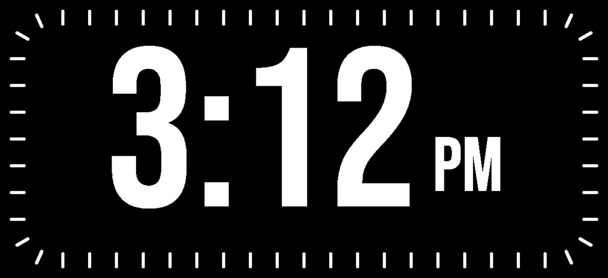
  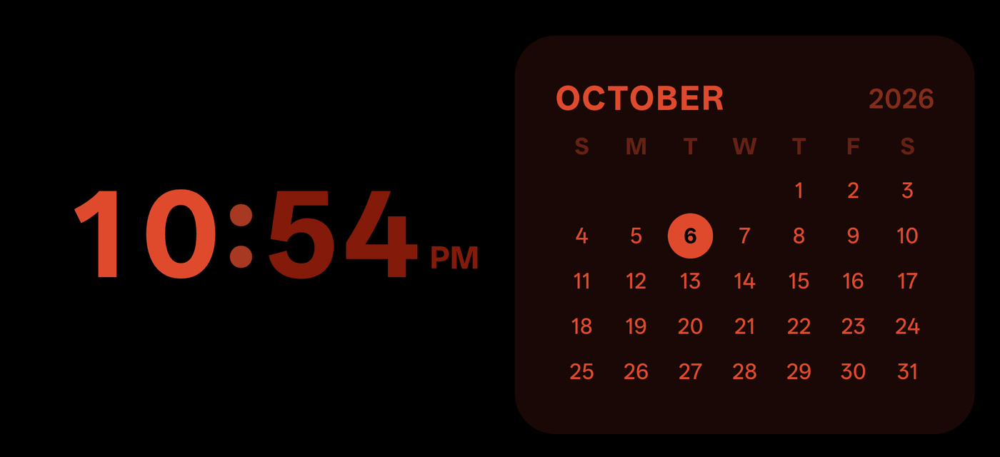
</p>
<p align="center">
  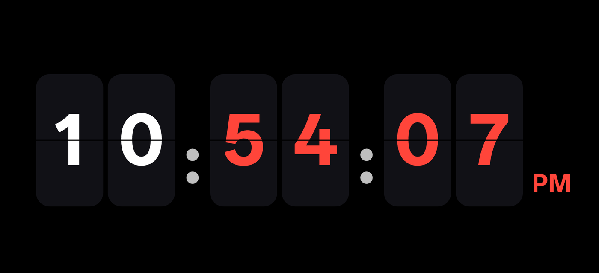
  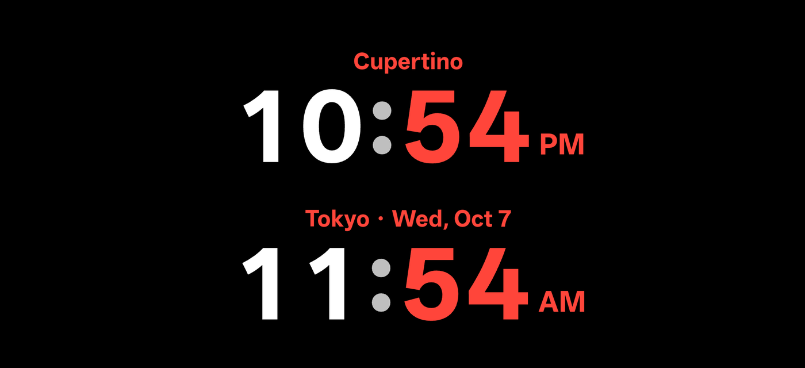
</p>
<p align="center">
  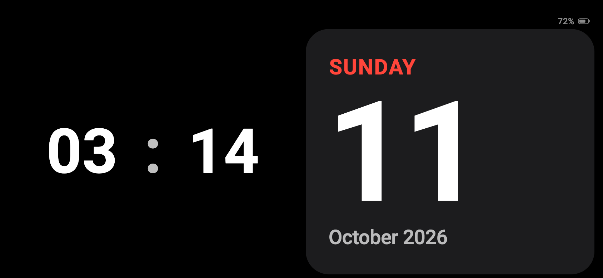
</p>

*The clock screenshots are from an Android phone. The settings dock and the music screenshots below are rendered from the app's own widgets with sample data (`app/tool`), so they show the current look.*

## What's new in v3

**Clocks follow the phone's orientation.** Held upright, Digital, Mono, Flip, Float and World stack the hours over the minutes so the digits fill the tall screen; turned sideways they go back on one line. The parts glide between the two arrangements on a spring: the hours rise to the top, the minutes settle at the bottom, the colon folds away. With two panels, World and Flip stay on one line whichever way the phone is held.

<p align="center">
  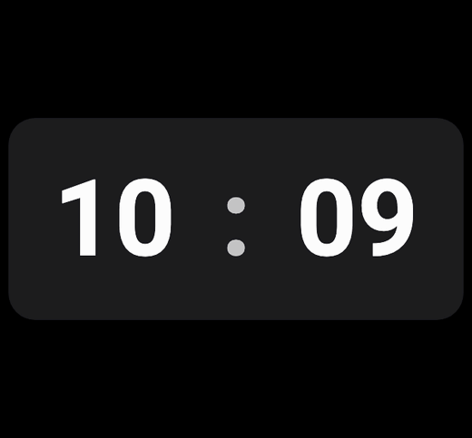
</p>

**Summary panel.** A fifth panel with five tiles: the time here, the time in a second city, today's date, the weather and the music card (the very same card as the Music panel, so it keeps seek, devices, volume, queue and search). The tiles deal in one after another like little cards. Hold any tile and they all start to jiggle like the iOS home screen: drag one onto another to swap them, drag the music tile to another column, and tap Done. The arrangement is saved. Tap the second city to search for another. It is only available with one panel.

<p align="center">
  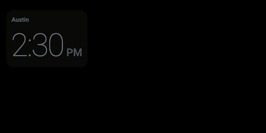
</p>

**Page indicator.** After you swipe to another panel, a row of small symbols (clock, sun, calendar, note, dashboard) appears for a moment, then fades. Press one and slide: a glass strip lists every page and lights the one under your finger (Weather, then Calendar, then Music, then Summary); lift your finger to go there. A tap does the same. While the symbols are hidden, the first touch only brings them back.

<p align="center">
  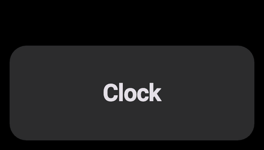
</p>

**Weather has four pages**, swiped up and down, with small dots and a name for each (the second city's own name once you have chosen one):
1. now, with the animated scene
2. the same card in Fahrenheit
3. the forecast: the next hours, then the days ahead with a range bar for each
4. the weather in your second city (the same city search as the second clock)

The Summary panel's weather tile swipes through the same four pages. The clock (its styles) and the calendar (Today / Month) show the same dots and a name after an up or down swipe.

<p align="center">
  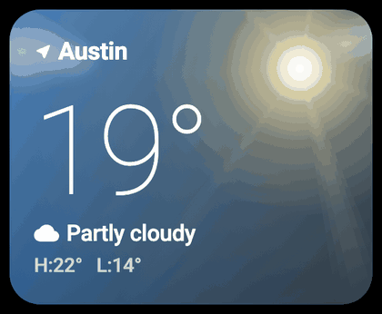
</p>

**Music card buttons.** Pressing a button springs it in and out with a soft glow, Play and Pause morph into each other, Previous and Next hop in their direction. Hold a button and a glass label names it; hold Next to see the song that is coming. Tap the source at the top to pick a device (your Mac, a speaker) from a list, like AirPlay's.

<p align="center">
  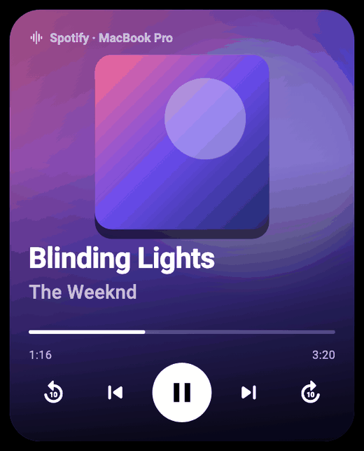
</p>

**Also new**
- **Settings in iOS style:** a dock that springs open and can be dragged away by its header (a flick sends it where the flick was heading), grouped sections, iOS-style switches, sliders and chips, bouncing scroll, and a compact keyboard whose keys are larger in portrait.
- **Animations switch** (All settings): turns off every spring, slide and the moving weather backdrop to save battery. The phone's own Reduce Motion setting does the same.
- **Rotation follows the phone while rotation lock is on:** turn the phone sideways and the screen follows after a moment, turn it back and it returns. If you flip it 180 degrees (landscape to the other landscape) it turns the screen over too. It waits until you stop touching the screen, so swiping never rotates it.

*All animations in this section are recorded from the app's own widgets with sample data (`app/tool/readme_gifs_test.dart`).*

## Spotify and music

The music card has three small buttons in its header: **queue**, **search** and **volume**.

<p align="center">
  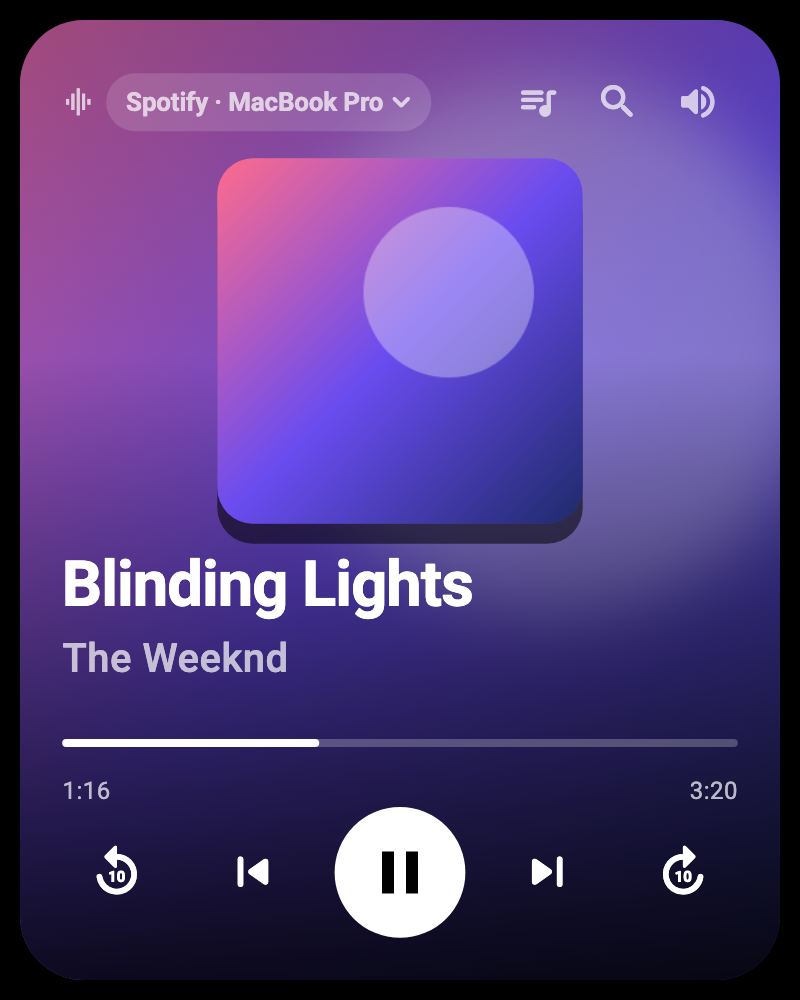
</p>

**Search.** Tap the magnifier to search Spotify. You type on the app's own keyboard, so the phone's keyboard never covers the screen. Songs, albums and playlists show up as a list while you type. Tap a result to play it, or tap **+** on a song to add it to the queue.

<p align="center">
  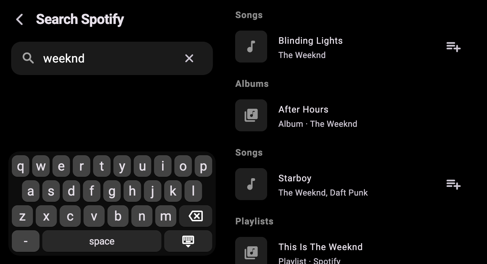
</p>

**Queue.** Tap the queue button and the card turns into Spotify's queue list: what is playing now and what comes next. Tap a song to jump to it. The list has its own **search button** at the top, so you can find a song and add it without leaving the queue. It refreshes by itself, and closes after a while without a touch.

<p align="center">
  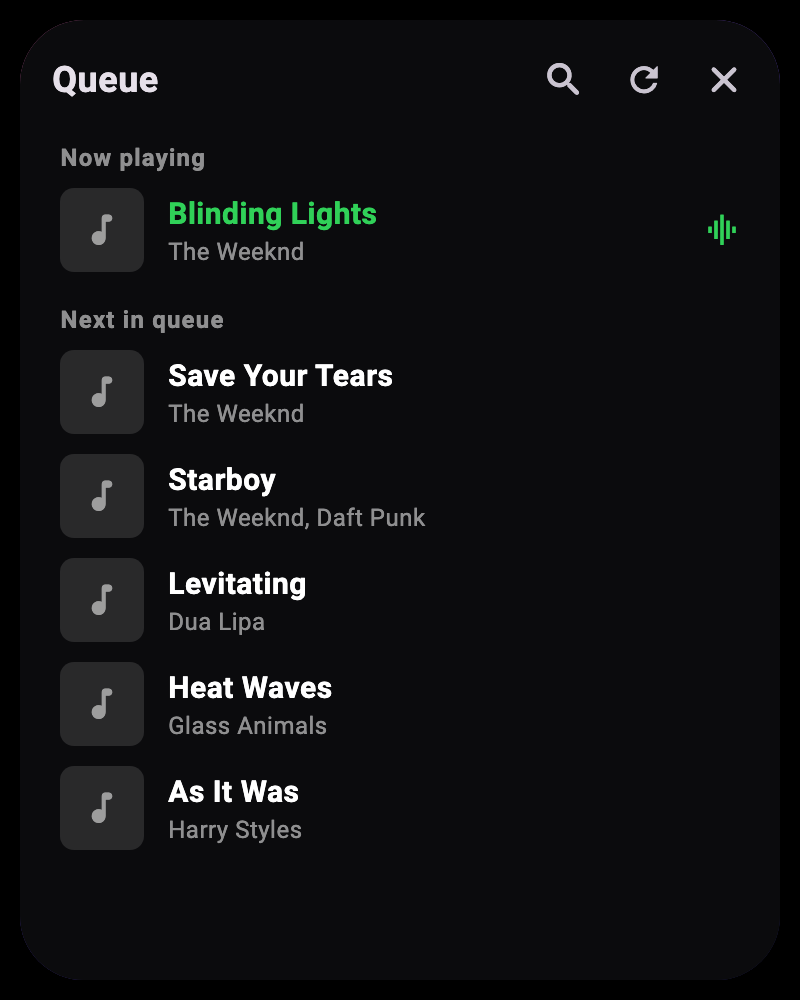
</p>

**Volume.** Tap the speaker icon to open a volume bar for the device that is playing (a speaker, a Mac, the phone...). It closes by itself after a few seconds.

<p align="center">
  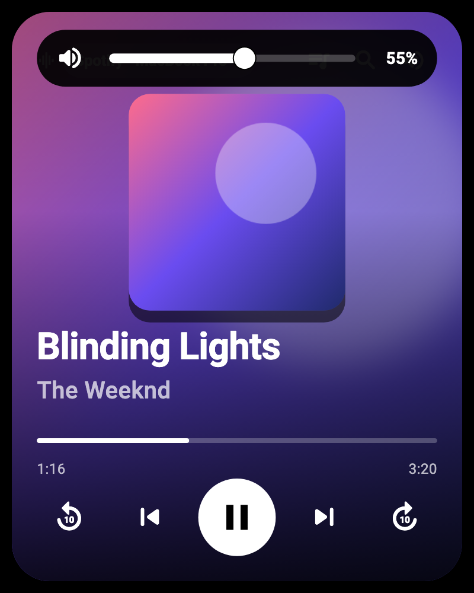
</p>

**Music settings.** The volume of the playing device, which player the card follows, sign in and out of Spotify, the device to play on (your choice shows at once), and your playlists.

<p align="center">
  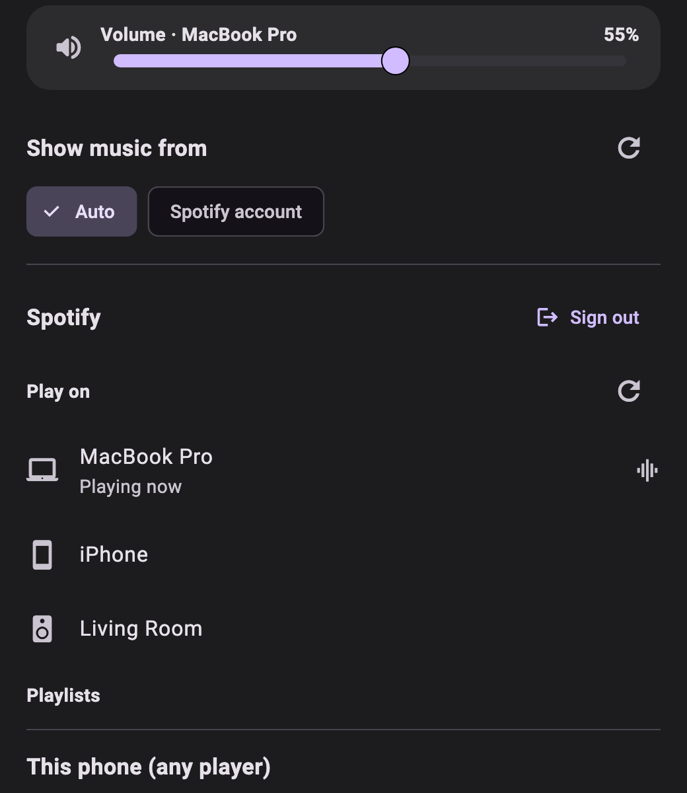
</p>

*Sample song and device names.*

## Features

**Clocks**
- Styles: digital, analog, frame (condensed digits inside a fading ring of 60 ticks that runs around the whole panel, so in one-panel mode it fills the screen), flip (one card per digit, with a seconds card), mono, float, text and world clock.
- Color per part (hours, minutes, colon, label, ticks), ready-made presets such as "Red & white" and "Night red", and an app accent that is separate from the clock look.
- World clock with worldwide city search and an on-screen keyboard. If the second city is on another date, its label shows the day and date.
- 12/24-hour time, optional seconds, adjustable size, no per-second layout jumps.

**Cards**
- **Weather:** animated Apple-style scenes (sun, clouds, rain, snow, fog, storm, night sky) from your phone's location, with Fahrenheit, forecast and second-city pages (swipe up and down).
- **Calendar:** today or the whole month (swipe up or down).
- **Music:** now playing with a sharp album cover over a soft blurred backdrop, transport, 10-second skips, hold-the-progress-bar to seek, a device menu and Spotify volume.
- **Summary:** time here and in a second city, the date, the weather and the music card in one rearrangeable panel.

**Spotify**
- Sign in with Spotify and control playback on any device: a Mac, a speaker, a TV or the phone itself (Spotify Premium is needed for control).
- Pick the playing device, start a playlist, and set the volume of that device from the music card or Music settings.
- **Search** from the music card (magnifier icon): type on the app's own keyboard and see songs, albums and playlists. Tap one to play it, or tap "+" on a song to add it to the queue.
- **Queue** from the music card (queue icon): the card turns into Spotify's queue list, with what is playing now and what is next, right in the card. Tap a song to jump to it. The list has its own search button to find and add songs. It closes by itself after a while.
- Sign out and sign in again with a different account at any time.

**Layout and gestures**
- **Fits any screen:** Dockwise reads the screen size once at start and lays everything out on a standard phone size, then scales the whole interface to the real screen. An iPhone 15, an iPhone 17 Pro Max and a tablet show the same composition at their own size, in portrait and landscape.
- One or two panels. Pinch with two fingers: spread = one panel (the one you spread on), pinch together = two panels (the panels slide apart or together on a spring), back in the original order.
- Swipe sideways to change the card, swipe up or down to change the clock style, the calendar view or the weather page.
- Tap any panel to open a settings dock whose changes preview live behind it. Drag the dock's header to move it away.

**Night and battery**
- **Auto brightness:** the screen stays on while charging and follows the room light, like Apple's StandBy: dimmer in a dark bedroom, up to the brightness you set in daylight. It reads the light sensor and eases between levels, so a passing shadow does not flicker it.
- **Night mode:** choose your own hours, and it also turns on by itself when the room is dark. Colors fade to a dim red, amber or your accent color with no blue light, with an adjustable strength.
- **OLED care (burn-in protection):** three layers, the same ideas always-on phones and TVs use.
  - *Orbiting:* once a minute the whole screen glides to a new spot on a slow orbit that never repeats, spreading every edge and every digit across the safe area instead of sitting on the same pixels.
  - *Dim when idle:* after 2, 5 (default) or 10 minutes without a touch, the screen drops to about half brightness. A touch wakes it at once. A bright, static clock is what wears an OLED, so this matters most.
  - *Room-light brightness:* in a dark room the screen is far dimmer (see Auto brightness), which cuts wear further.
- **Battery badge:** a tiny percentage in the top-right corner, shown only when the battery is not full on the charger (grey on battery, green charging, red when low).
- **Low-battery prompt:** at a level you choose (5-50%, default 20%) and not charging, a full-screen "Charge your phone" prompt appears until you plug in. It can be turned off in settings.

**Rotation**
- If the screen is not turned the way you are holding the phone (for example iPhone rotation lock is on), Dockwise follows the phone by itself after a moment, using the gravity sensor, and a small rotate symbol at the bottom edge works as a manual fallback. It also notices when the phone is flipped 180 degrees. It never rotates while you are touching the screen.

**Auto-start (Android only)**
- Opens Dockwise by itself when the phone is charging and propped up in landscape, and closes it when you unplug. Details below.

## Animations

**Flip clock:** every digit is its own card. The seconds digit flips each second, and a digit only flips when it changes (here: 10:59:57 rolling over to 11:00:02).

<p align="center">
  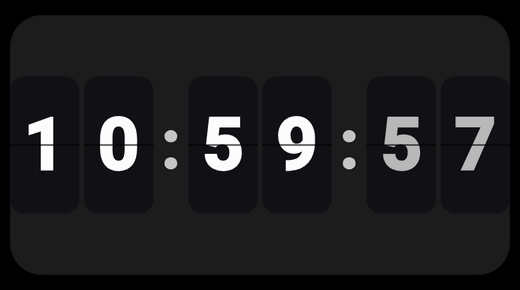
</p>

**Weather scenes** (sun, clouds, fog, night sky, rain, snow, storm) and the **low-battery prompt** (battery drops to the alert level, the prompt fades in, then fades out when the charger is plugged in):

<p align="center">
  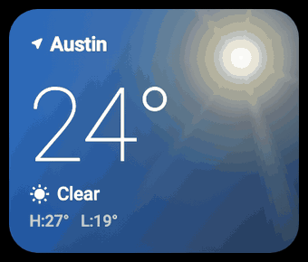
  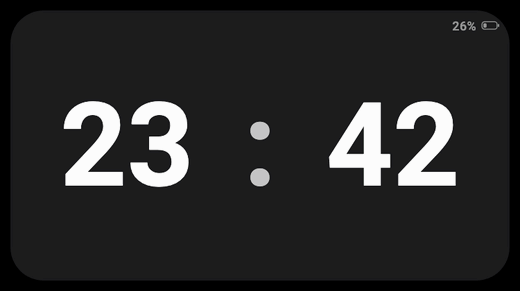
</p>

*Every animation is recorded from the app's own widgets with sample data (`app/tool`).*

## Platforms

| Feature | Android | iPhone |
|---|---|---|
| All clock styles, themes, presets, layouts, pinch | Yes | Yes |
| Weather, calendar, world clock | Yes | Yes |
| Night mode, burn-in shift, keep awake | Yes | Yes |
| Brightness that follows the room light | Yes, with the light sensor | Through iOS's own auto-brightness (iPhone does not let apps read the sensor) |
| Night look when the room is dark | Yes | No (hours only) |
| Spotify account control and volume | Yes | Yes |
| Battery badge and low-battery prompt | Yes | Yes |
| Spotify search and queue | Yes | Yes |
| Follows the phone's rotation (works with rotation lock on) | Yes | Yes |
| Show and control music from other apps on the phone | Yes | No (iOS does not allow it) |
| Open itself when docked and charging | Yes | No (iOS does not allow it; use the built-in StandBy) |

### Android auto-start

When enabled, a small foreground service watches the charger. While charging, it reads the gravity sensor at a low rate and opens Dockwise once the phone has been propped up (default 40° or more from flat) in landscape for 1.5 seconds. It closes the app as soon as you unplug, but only if it opened itself and you have not taken over the screen (opened it yourself, or pressed Home). To launch from the background it uses "Display over other apps" and a full-screen notification over the lock screen. In the app go to Settings > All settings > Auto-start; a checklist there shows what still needs to be allowed (overlay, notifications, battery set to Unrestricted).

## Permissions

| Platform | Permission | Used for |
|---|---|---|
| Both | Location, only while the app is open | Local weather and your city name |
| Both | Internet | Weather (Open-Meteo, BigDataCloud) and Spotify |
| Both | Motion sensor (no prompt needed) | The rotation hint reads the gravity direction |
| Android | Light sensor (no prompt needed) | Auto brightness and the dark-room night look |
| Android | Notification access (optional) | Reading what other apps are playing |
| Android | Display over other apps, full-screen notifications, foreground service, boot completed, wake lock | Auto-start and keeping the tilt sensor alive while charging |
| iPhone | None beyond location | |

Your location is used only to look up weather and a city name and is not stored anywhere but on your device.

## Getting Started

### 1. Install what you need

The full checklist with versions is in [requirements.txt](requirements.txt). Easiest is to let a script install whatever is missing:

| Your computer | Run | Builds for |
|---|---|---|
| **Mac** | `./scripts/setup_mac.sh` | Android and iPhone |
| **Windows** | `.\scripts\setup_windows.ps1` (in PowerShell) | Android only |

Add `--check` (Mac) or `-Check` (Windows) to only see what is missing without installing anything. Both scripts are safe to run again. They install Flutter, JDK 17 and Android Studio (plus CocoaPods on a Mac), set Flutter up to use JDK 17, accept the Android licenses, run `flutter pub get` and finish with `flutter doctor`.

> The Mac script has been tested. The Windows script follows the same steps but has not been run on a Windows PC yet. If it fails, the manual steps below do the same thing.

**Manual install, if you prefer**
1. Install [Flutter](https://docs.flutter.dev/get-started/install) (3.41 or newer) and make sure `flutter` works in a new terminal.
2. Install JDK 17 and tell Flutter to use it: `flutter config --jdk-dir <path to JDK 17>`.
3. Install [Android Studio](https://developer.android.com/studio), open it once to finish its setup wizard, then run `flutter doctor --android-licenses` and answer `y`.
4. Mac and iPhone only: install Xcode from the App Store, then `brew install cocoapods`.
5. Run `flutter doctor` and fix anything it marks with a cross.

### 2. Get the code

```bash
git clone https://github.com/HardikKotangale/Dockwise.git
cd Dockwise
```

### 3. Connect your phone

- **Android:** Settings > About phone, tap *Build number* 7 times, then Settings > Developer options > turn on *USB debugging*. Plug the phone in and accept the prompt. `flutter devices` should list it.
- **iPhone:** Settings > Privacy & Security > turn on *Developer Mode* and restart. Plug in the iPhone and tap *Trust*. Then open `app/ios/Runner.xcworkspace` in Xcode once, pick your Apple ID under *Signing & Capabilities > Team*, and close Xcode.

An Android emulator from Android Studio also works.

### 4. Run it

```bash
cd app
flutter pub get
flutter devices                       # find your phone's id
flutter run                           # Android (add -d <id> if you have several devices)
flutter run -d <iphone-id> --release  # iPhone
```

Always open `ios/Runner.xcworkspace`, never `Runner.xcodeproj`, or Xcode will say a plugin module was not found.

### 5. First run on the phone

- Allow **location** when asked (weather and your city name). You can say no; the clock still works.
- Optional, Android only: Settings > All settings > **Auto-start** to open Dockwise when you dock the phone. A checklist there shows what still needs to be allowed.
- Tap any panel to change clock style, colors and layout. Pinch with two fingers to switch between one and two panels.

### 6. Spotify (optional)

1. Create an app at <https://developer.spotify.com/dashboard> and add the redirect URI `dockwise://spotify-callback`.
2. Copy `app/lib/src/services/spotify_config.example.dart` to `app/lib/src/services/spotify_config.dart` and paste your Client ID. That file is git-ignored, so your Spotify app is never committed. (The setup scripts create the file for you.)
3. Or pass it at build time: `flutter run --dart-define=SPOTIFY_CLIENT_ID=your_id`.
4. In the app, open the music card's settings and tap **Connect Spotify**. Spotify Premium is needed to control playback.

### 7. Tests

```bash
cd app
flutter test
flutter analyze
cd android && ./gradlew :app:testDebugUnitTest   # tilt-detection unit tests (Windows: gradlew.bat)
```

### Troubleshooting

| Problem | Fix |
|---|---|
| `flutter doctor` shows Android licenses not accepted | `flutter doctor --android-licenses` and answer `y` |
| Gradle fails with "Unsupported class file" or a Java version error | Flutter is using the wrong JDK: `flutter config --jdk-dir <path to JDK 17>` |
| No devices listed | Check the cable and *USB debugging*, accept the prompt on the phone, then `adb kill-server` and try again |
| Xcode: `Module 'flutter_web_auth_2' not found` | Open `ios/Runner.xcworkspace`, not the `.xcodeproj` |
| iPhone says the developer is not trusted | Settings > General > VPN & Device Management > trust your Apple ID |
| iPhone app stops opening after 7 days | A free Apple ID expires after 7 days; run it from Xcode or `flutter run` again |
| Spotify login opens but does not come back | The redirect URI in the Spotify dashboard must be exactly `dockwise://spotify-callback` |
| Spotify says it needs a Client ID | Create `spotify_config.dart` as described above |

## Project Layout

- `app/lib/src/domain`: settings, themes, presets and the data shown on the cards.
- `app/lib/src/core`: pinch gesture, night-mode policy, clock cadence and burn-in policy, and `motion/` (springs, press feedback, glass, the page indicator, the clock morph).
- `app/lib/src/features/standby`: the main screen and dashboard, `settings/` pages, `widgets/` (one file per clock style under `clock/`, weather, calendar, music and Summary cards, battery, keyboard).
- `app/lib/src/services`: Spotify, weather, city search and the native bridge.
- `app/android/.../standbypro`: auto-start service, posture (tilt) logic, media session bridge.
- `app/ios/Runner`: small Swift bridge for keep-awake and brightness.
- `scripts`: one-command setup for macOS and Windows. `requirements.txt` lists everything the project needs.
- `spec`: formal models (PlusCal, checked with the TLC model checker) of the posture detection and the auto-launch logic, with the bugs they found. See [spec/README.md](spec/README.md).
- `docs`: screenshots and animations used in this README, and [ARCHITECTURE.md](docs/ARCHITECTURE.md).
- `app/tool`: records the README animations (`flutter test tool/readme_gifs_test.dart`, then `python3 tool/frames_to_gif.py`).

## License

MIT. See [LICENSE](LICENSE).
